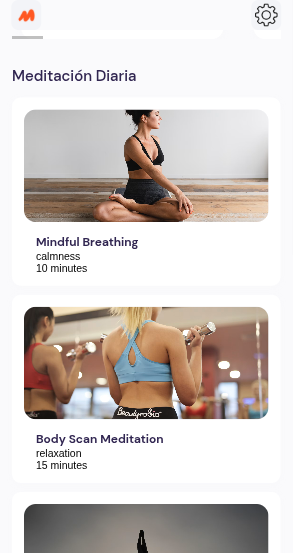
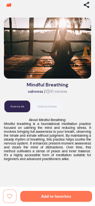
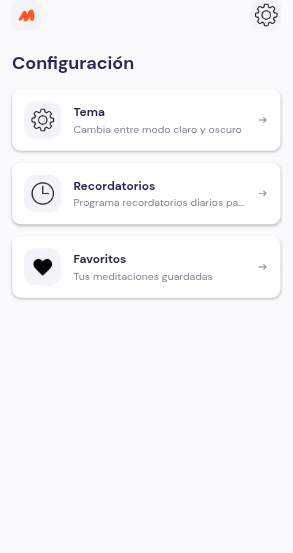
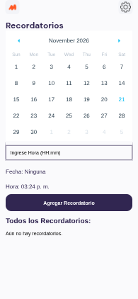

# MeditationApp 🧘

Aplicación móvil de meditación desarrollada con **React Native** y **Expo** como proyecto final de un curso de Coursera.

Permite registrarse, explorar un catálogo de meditaciones guiadas con instrucciones paso a paso, guardar favoritas, programar recordatorios diarios y cambiar entre tema claro y oscuro. Funciona en **Android**, **iOS** y **web**.

## Funcionalidades

- **Registro e inicio de sesión.** Validación de campos y almacenamiento local del usuario con AsyncStorage; la sesión se mantiene al reabrir la app.
- **Pantalla de inicio.** Saludo personalizado, frase inspiradora del día (obtenida de [DummyJSON](https://dummyjson.com/docs/quotes)), meditaciones populares y meditaciones diarias.
- **Detalle de meditación.** Imagen, duración, objetivo, descripción e instrucciones paso a paso, organizadas en pestañas.
- **Compartir.** Usa el menú nativo de compartir en el celular; en el navegador, Web Share API o copia al portapapeles.
- **Favoritos.** Guarda tus meditaciones preferidas para acceder a ellas rápidamente.
- **Recordatorios diarios.** Elige fecha en un calendario y hora; recibes una notificación local (`expo-notifications` en móvil, Notifications API en web).
- **Tema claro / oscuro.** Cambiable desde la configuración.

Los requisitos del proyecto están descritos como historias de usuario en [meditation_user_stories.md](meditation_user_stories.md).

## Capturas de pantalla

<table>
  <tr>
    <td align="center"></td>
    <td align="center"></td>
    <td align="center"></td>
    <td align="center"></td>
  </tr>
  <tr>
    <td align="center"><b>Inicio</b><br>Meditaciones diarias</td>
    <td align="center"><b>Detalle</b><br>Descripción e instrucciones</td>
    <td align="center"><b>Configuración</b><br>Tema, recordatorios y favoritos</td>
    <td align="center"><b>Recordatorios</b><br>Calendario y hora</td>
  </tr>
</table>

## Tecnologías

| Área | Herramienta |
|---|---|
| Framework | React Native 0.74 + Expo SDK 51 |
| Navegación | Expo Router (rutas basadas en archivos) |
| Persistencia | `@react-native-async-storage/async-storage` |
| Notificaciones | `expo-notifications` |
| Calendario / hora | `react-native-calendars`, `@react-native-community/datetimepicker` |
| Estado global | React Context (tema) |
| Fuentes | DM Sans (`expo-font`) |

> Los datos de las meditaciones son locales (simulan una API en [`hook/useFetch.js`](hook/useFetch.js)); la app no requiere backend.

## Estructura del proyecto

```
app/                      Pantallas (Expo Router)
├── _layout.js            Layout raíz: fuentes, tema y navegación
├── index.js              Redirige a /home o /login según la sesión
├── login.js, signup.js   Autenticación
├── home.js               Pantalla principal
├── meditation-details/
│   └── [id].js           Detalle de una meditación
└── settings/
    ├── index.js          Menú de configuración
    ├── ThemeChange.js    Tema claro / oscuro
    ├── Favourites.js     Meditaciones favoritas
    └── DailyReminders.js Recordatorios
components/               Componentes reutilizables
constants/                Colores, tamaños, fuentes e iconos
context/ThemeProvider.js  Contexto del tema
hook/useFetch.js          Datos de meditaciones
assets/                   Imágenes, iconos y fuentes
```

## Cómo ejecutarlo

### Requisitos

- [Node.js](https://nodejs.org/) 18 o superior
- La app **Expo Go** en tu celular ([Android](https://play.google.com/store/apps/details?id=host.exp.exponent) / [iOS](https://apps.apple.com/app/expo-go/id982107779)), o un emulador de Android

### Instalación

```bash
git clone https://github.com/elvisdev89/meditationApp.git
cd meditationApp
npm install
```

### Ejecución

```bash
npm start          # inicia el servidor de desarrollo (escanea el QR con Expo Go)
npm run android    # abre en un emulador o dispositivo Android
npm run ios        # abre en el simulador de iOS (solo macOS)
npm run web        # abre en el navegador (http://localhost:8081)
```

Al abrir la app por primera vez, **regístrate** y luego inicia sesión con esos datos.

### Generar un APK (Android)

El proyecto incluye [`eas.json`](eas.json) para compilar con [EAS Build](https://docs.expo.dev/build/introduction/):

```bash
npm install -g eas-cli
eas login
eas build -p android --profile preview
```

Al terminar, EAS entrega un enlace para descargar e instalar el APK en el celular.

## Limitaciones conocidas

- Los datos del usuario se guardan **solo en el dispositivo** y la contraseña no está cifrada; la autenticación es únicamente demostrativa.
- En **web**, los recordatorios solo se disparan mientras la pestaña está abierta y pueden programarse como máximo con ~24 días de anticipación.
- En **Expo Go**, las notificaciones tienen limitaciones en Android; para probarlas por completo se recomienda un *development build*.

## Autor

**elvisdev89** — [GitHub](https://github.com/elvisdev89)

## Licencia

Este proyecto está bajo la licencia [MIT](LICENSE).
